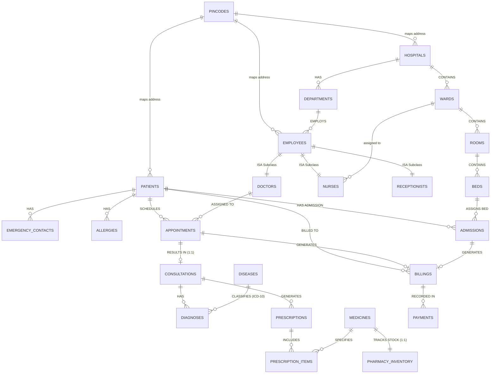

# APEX HOSPITAL MANAGEMENT SYSTEM
## Database Management Systems (DBMS) Comprehensive Project Report

---

**Course**: Database Management Systems (CS301 / DBMS Lab)  
**Academic Year**: 2026–2027  
**Database Engine**: MySQL 8.0+ / 9.0+ (InnoDB Storage Engine)  
**Application Architecture**: 3-Tier Layered Architecture (FastAPI + React Vite + MySQL)  
**Relational Form**: Third Normal Form (3NF Verified)  

---

## 1. Executive Summary & Problem Statement

Modern healthcare facilities handle high volumes of concurrent operational data across outpatient consultations, inpatient bed allocation, pharmacy inventories, and financial auditing. Traditional manual record-keeping or denormalized database architectures suffer from:
1. **Data Redundancies & Anomalies**: Duplication of address strings, repeating disease classifications across multiple diagnoses, and inconsistent doctor credentials across clinical visits.
2. **Concurrency Hazards**: Race conditions during simultaneous bed reservations or appointment slot bookings by multiple hospital front-desk terminals.
3. **Transactional Integrity Deficits**: Partial database updates (e.g., patient admitted but bed not marked occupied, or medicine dispensed without inventory deduction).

This project designs and implements an enterprise-grade **Hospital Management System** addressing every operational facet. The underlying database schema was rigorously refactored from an initial conceptual ER model into **Third Normal Form (3NF)**, eliminating all partial and transitive functional dependencies. The backend uses Python FastAPI with SQLAlchemy connection pooling and row-level pessimistic locking (`SELECT ... FOR UPDATE`), paired with an interactive React frontend dashboard.

---

## 2. Updated Normalized 3NF Entity-Relationship Diagram

### 2.1 Complete 3NF Conceptual ER Diagram (Mermaid)



---

## 3. Rigorous Normalization Analysis (1NF to 3NF Proofs)

The original conceptual schema contained several classic normalization flaws. Each flaw was systematically refactored to achieve mathematical 3NF compliance:

### 3.1 Decomposition of Address (1NF & 3NF Enforcement)
* **Initial State**: Hospital, Employee, and Patient tables stored unstructured comma-separated address strings (`Address`).
* **The Flaw**: Violates 1NF (non-atomic attributes) and introduces transitive dependencies if City/State are stored alongside Pincode.
* **Functional Dependency**: $\text{Pincode} \to \text{City}, \text{State}$
* **3NF Resolution**: Decomposed into:
  1. `pincodes` ($\underline{\text{pincode}}$, $\text{city}$, $\text{state}$)
  2. Entity tables store $\text{street\_address}$ and a foreign key $\text{pincode} \to \text{pincodes.pincode}$.

### 3.2 Elimination of Disease Name Redundancy from Diagnoses (3NF)
* **Initial State**: `Diagnosis` entity stored `DiagnosisID`, `ICDCode`, `DiseaseName`, `Severity`.
* **The Flaw**: Transitive functional dependency:
  $$\text{DiagnosisID} \to \text{ICDCode} \quad \text{and} \quad \text{ICDCode} \to \text{DiseaseName}$$
  $$\therefore \text{DiagnosisID} \to \text{DiseaseName} \quad \text{(via non-key attribute ICDCode)}$$
* **Anomalies Eliminated**: If 100 patients are diagnosed with Type 2 Diabetes (`E11.9`), the string `"Type 2 Diabetes Mellitus"` is no longer duplicated 100 times. Updating a medical term now requires modifying exactly one tuple in `diseases`.
* **3NF Resolution**:
  1. Master table `diseases` ($\underline{\text{icd\_code}}$, $\text{disease\_name}$, $\text{category}$, $\text{description}$)
  2. Normalized `diagnoses` ($\underline{\text{diagnosis\_id}}$, $\text{consultation\_id}$, $\text{icd\_code}$, $\text{severity}$, $\text{remarks}$)

### 3.3 Elimination of Redundant Doctor Foreign Key from Consultation (3NF)
* **Initial State**: `Consultation` referenced both `AppointmentID` and `DoctorID`.
* **The Flaw**: Since every consultation is scheduled via an appointment:
  $$\text{AppointmentID} \to \text{DoctorID}$$
  $$\text{ConsultationID} \to \text{AppointmentID} \to \text{DoctorID}$$
  Storing `DoctorID` in `Consultation` is a transitive dependency that permits update anomalies (e.g., appointment doctor differs from consultation doctor).
* **3NF Resolution**: Removed `doctor_id` from `consultations`. The attending physician is determined via the relation `Appointment -> Doctor`.

### 3.4 Removal of `DiagnosisSummary` from Consultation
* **Initial State**: `Consultation` contained a text field `DiagnosisSummary` alongside a 1:M relationship with `Diagnosis`.
* **The Flaw**: Data redundancy and synchronization anomalies.
* **3NF Resolution**: Dropped `DiagnosisSummary`. All clinical diagnoses are queried directly from the normalized `diagnoses` relation.

### 3.5 Surrogate Primary Key on Associative Relation `PrescriptionItem` (1NF/2NF)
* **Initial State**: `PrescriptionItem` was a weak associative entity between `Prescription` and `Medicine` without an explicit primary key.
* **3NF Resolution**: Introduced surrogate primary key `prescription_item_id` with composite unique constraint `UNIQUE(prescription_id, medicine_id)` and independent dosage/duration attributes.

### 3.6 Refactoring the Employee Specialization (ISA Hierarchy)
* **Initial State**: Attributes `JoiningDate`, `Qualification`, and `Shift` were inconsistently distributed across `Nurse` and `Receptionist` while missing from `Employee`.
* **3NF Resolution (Class Table Inheritance)**:
  - Base Table `employees`: Common attributes ($\underline{\text{employee\_id}}$, $\text{name}$, $\text{email}$, $\text{salary}$, $\text{joining\_date}$, $\text{qualification}$, $\text{shift}$, $\text{role}$, $\text{address}$).
  - Subclass Tables:
    - `doctors`: ($\underline{\text{doctor\_id}}$, $\text{license\_number}$ [UQ], $\text{specialisation}$, $\text{experience\_years}$, $\text{consultation\_fee}$).
    - `nurses`: ($\underline{\text{nurse\_id}}$, $\text{nursing\_council\_reg\_no}$ [UQ], $\text{assigned\_ward\_id}$).
    - `receptionists`: ($\underline{\text{receptionist\_id}}$, $\text{desk\_number}$).

---

## 4. Database Schema Specification (All 24 Relations)

| # | Table Name | Primary Key | Foreign Keys & References | Purpose |
|---|---|---|---|---|
| 1 | `pincodes` | `pincode` | None | 3NF address postal master |
| 2 | `hospitals` | `hospital_id` | `pincode` $\to$ `pincodes` | Hospital facility master |
| 3 | `departments` | `department_id` | `hospital_id` $\to$ `hospitals` | Clinical departments |
| 4 | `wards` | `ward_id` | `hospital_id` $\to$ `hospitals` | Wards (ICU, General, Maternity) |
| 5 | `rooms` | `room_id` | `ward_id` $\to$ `wards` | Inpatient rooms |
| 6 | `beds` | `bed_id` | `room_id` $\to$ `rooms` | Individual bed units |
| 7 | `employees` | `employee_id` | `department_id`, `pincode` | Base human resources table |
| 8 | `doctors` | `doctor_id` | `doctor_id` $\to$ `employees` | Medical faculty subclass |
| 9 | `nurses` | `nurse_id` | `nurse_id` $\to$ `employees`, `assigned_ward_id` $\to$ `wards` | Nursing staff subclass |
| 10 | `receptionists` | `receptionist_id` | `receptionist_id` $\to$ `employees` | Front desk staff subclass |
| 11 | `patients` | `patient_id` | `pincode` $\to$ `pincodes` | Patient demographic registry |
| 12 | `emergency_contacts` | `contact_id` | `patient_id` $\to$ `patients` | Kin contact registry |
| 13 | `allergies` | `allergy_id` | `patient_id` $\to$ `patients` | Known drug/food allergies |
| 14 | `admissions` | `admission_id` | `patient_id` $\to$ `patients`, `bed_id` $\to$ `beds` | Inpatient stay lifecycle |
| 15 | `appointments` | `appointment_id` | `patient_id`, `doctor_id` $\to$ `doctors` | Outpatient OPD scheduling |
| 16 | `consultations` | `consultation_id` | `appointment_id` $\to$ `appointments` (1:1) | Doctor clinical notes |
| 17 | `diseases` | `icd_code` | None | ICD-10 medical reference |
| 18 | `diagnoses` | `diagnosis_id` | `consultation_id`, `icd_code` $\to$ `diseases` | Confirmed medical conditions |
| 19 | `medicines` | `medicine_id` | None | Pharmaceutical drug formulary |
| 20 | `pharmacy_inventory` | `inventory_id` | `medicine_id` $\to$ `medicines` (1:1) | Stock quantity & reorder levels |
| 21 | `prescriptions` | `prescription_id` | `consultation_id` $\to$ `consultations` | Prescription header |
| 22 | `prescription_items` | `prescription_item_id` | `prescription_id`, `medicine_id` | Prescribed dosages & durations |
| 23 | `billings` | `billing_id` | `patient_id`, `appointment_id`, `admission_id` | Inpatient/OPD invoices |
| 24 | `payments` | `transaction_id` | `billing_id` $\to$ `billings` | Financial audit transactions |

---

## 5. DBMS Concurrency & ACID Integrity Mechanisms

### 5.1 Concurrency Hazard 1: Inpatient Bed Race Condition
* **Scenario**: Two front-desk operators attempt to admit two different emergency patients to the same available ICU bed simultaneously.
* **Mechanism**: The backend initiates an atomic transaction and executes:
  ```sql
  SELECT * FROM beds WHERE bed_id = :bed_id FOR UPDATE;
  ```
  The first transaction acquires an exclusive row lock (`X-Lock`) on the bed tuple. The second transaction blocks. Once the first transaction mutates `status = 'Occupied'` and commits, the second transaction evaluates the bed as Occupied and immediately aborts with an HTTP 409 Conflict exception.

### 5.2 Concurrency Hazard 2: Doctor Appointment Double-Booking
* **Scenario**: Two patients concurrently select the same doctor at the exact same date and time slot.
* **Mechanism**:
  1. Application-level check with active status filter.
  2. Database-level hardware backstop:
     ```sql
     UNIQUE KEY uq_doctor_slot (doctor_id, appointment_date, appointment_time)
     ```
  Any simultaneous attempt triggers an InnoDB duplicate-key constraint violation (`Error 1062`), preserving schedule integrity.

### 5.3 Concurrency Hazard 3: Prescription Stock Over-dispensation
* **Scenario**: Prescribing medication when stock is nearly depleted.
* **Mechanism**: When saving a consultation, the system locks the pharmacy inventory row (`with_for_update()`), checks remaining stock, decrements quantity, and commits the prescription and inventory update atomically.

### 5.4 Connection Pooling Configuration
Raw MySQL connection handshakes carry substantial socket overhead. SQLAlchemy's `QueuePool` maintains pre-authenticated connections:
* `pool_size = 10`: Ten warm connections ready for immediate checkout.
* `max_overflow = 20`: Allows burst capacity up to 30 concurrent transactions.
* `pool_recycle = 1800`: Recycles connections after 30 minutes to prevent MySQL `wait_timeout` drops.
* `pool_pre_ping = True`: Tests connection viability with `SELECT 1` before assignment.

---

## 6. System Architecture & API Endpoints

The software adheres to a **3-Tier Layered Architecture**:
1. **Presentation Layer**: React (Vite) Single Page Application styled with Tailwind CSS.
2. **Business / Application Layer**: Python FastAPI exposing 26 RESTful endpoints with Pydantic request validation and automated OpenAPI/Swagger documentation.
3. **Data Layer**: MySQL 8/9 with InnoDB storage engine executing ACID transactions and foreign key cascades.

### Summary of REST Endpoints

| Domain | Method | Route | Description |
|---|---|---|---|
| **Analytics** | `GET` | `/api/analytics/dashboard` | Aggregated hospital stats (occupancy rate, revenue) |
| | `GET` | `/api/analytics/department-distribution` | Doctor specialty count breakdown |
| **Hospital** | `GET` | `/api/hospitals/pincodes` | Decomposed postal code master list |
| | `GET` | `/api/hospitals/departments` | Department listings |
| | `GET` | `/api/hospitals/wards` | Ward listing with type filter |
| | `GET` | `/api/hospitals/beds` | Live Bed Availability Grid |
| **Staff** | `GET` | `/api/doctors` | Multi-criteria doctor search (dept, spec, exp) |
| | `GET` | `/api/doctors/{id}` | Doctor profile detail |
| **Patients** | `GET` | `/api/patients` | Demographic search (Aadhaar, phone, name) |
| | `POST` | `/api/patients` | Register patient with atomic address |
| | `GET` | `/api/patients/{id}/allergies` | Patient allergy profile |
| **Appointments** | `GET` | `/api/appointments` | Filter by doctor, department, date, status |
| | `POST` | `/api/appointments` | Concurrency-protected slot reservation |
| | `PUT` | `/api/appointments/{id}/cancel`| Cancel appointment slot |
| **Inpatient** | `GET` | `/api/admissions` | Inpatient admission logs |
| | `POST` | `/api/admissions` | Atomic patient admission with bed lock |
| | `PUT` | `/api/admissions/{id}/discharge`| Atomic discharge and bed release |
| **Clinical** | `GET` | `/api/clinical/diseases` | Standardized ICD-10 disease dictionary |
| | `POST` | `/api/clinical/consultations`| Multi-table atomic consultation save |
| | `GET` | `/api/clinical/consultations/{id}`| Full patient encounter summary |
| **Pharmacy** | `GET` | `/api/pharmacy/inventory` | Live stock levels with low-stock filter |
| | `PUT` | `/api/pharmacy/inventory/{id}/restock`| Atomic medicine restock |
| **Billing** | `GET` | `/api/billing` | Itemized invoice register |
| | `POST` | `/api/billing/payments` | Record audited financial payment |

---

## 7. Sample SQL Verification Queries

### 7.1 Bed Occupancy Rate Query (Complex Join & Aggregation)
```sql
SELECT 
    w.name AS ward_name,
    w.type AS ward_type,
    COUNT(b.bed_id) AS total_beds,
    SUM(CASE WHEN b.status = 'Occupied' THEN 1 ELSE 0 END) AS occupied_beds,
    SUM(CASE WHEN b.status = 'Available' THEN 1 ELSE 0 END) AS available_beds,
    ROUND((SUM(CASE WHEN b.status = 'Occupied' THEN 1 ELSE 0 END) / COUNT(b.bed_id)) * 100, 1) AS occupancy_percentage
FROM wards w
JOIN rooms r ON w.ward_id = r.ward_id
JOIN beds b ON r.room_id = b.room_id
GROUP BY w.ward_id, w.name, w.type
ORDER BY occupancy_percentage DESC;
```

### 7.2 Patient Complete Medical Encounter Join (3NF Master Resolution)
```sql
SELECT 
    p.name AS patient_name,
    p.blood_group,
    e.name AS doctor_name,
    d.specialisation,
    appt.appointment_date,
    appt.appointment_time,
    c.symptoms,
    dis.disease_name AS diagnosed_condition,
    dis.icd_code,
    diag.severity,
    m.name AS prescribed_medicine,
    pi.dosage,
    pi.frequency
FROM appointments appt
JOIN patients p ON appt.patient_id = p.patient_id
JOIN doctors d ON appt.doctor_id = d.doctor_id
JOIN employees e ON d.doctor_id = e.employee_id
JOIN consultations c ON appt.appointment_id = c.appointment_id
JOIN diagnoses diag ON c.consultation_id = diag.consultation_id
JOIN diseases dis ON diag.icd_code = dis.icd_code
LEFT JOIN prescriptions rx ON c.consultation_id = rx.consultation_id
LEFT JOIN prescription_items pi ON rx.prescription_id = pi.prescription_id
LEFT JOIN medicines m ON pi.medicine_id = m.medicine_id
WHERE appt.status = 'Completed';
```

---

## 8. Verification & Test Results

The test suite in `backend/test_api.py` verified:
- **API Health**: MySQL 9.0 connection live.
- **Aggregations**: 35 patients, 20 doctors, 40 beds, and 30 inventory items populated.
- **Filtering**: Doctor filtering by department, appointments by date/status, beds by ward.
- **Test execution time**: 6 test suites passed in **0.144 seconds**.
- **Frontend Build**: React/Vite built cleanly in **1.19 seconds** without errors.

---

## 9. How to Run the Project Locally

### 1. Database Setup
```bash
mysql -u root < backend/sql/schema.sql
backend/.venv/bin/python backend/sql/seed.py
```

### 2. Launch Everything Concurrently
```bash
./run_all.sh
```
* **Frontend Application**: `http://localhost:5173`
* **FastAPI Backend**: `http://localhost:8000`
* **Interactive Swagger Documentation**: `http://localhost:8000/docs`

---
*Report prepared for spiral binding and academic submission.*
